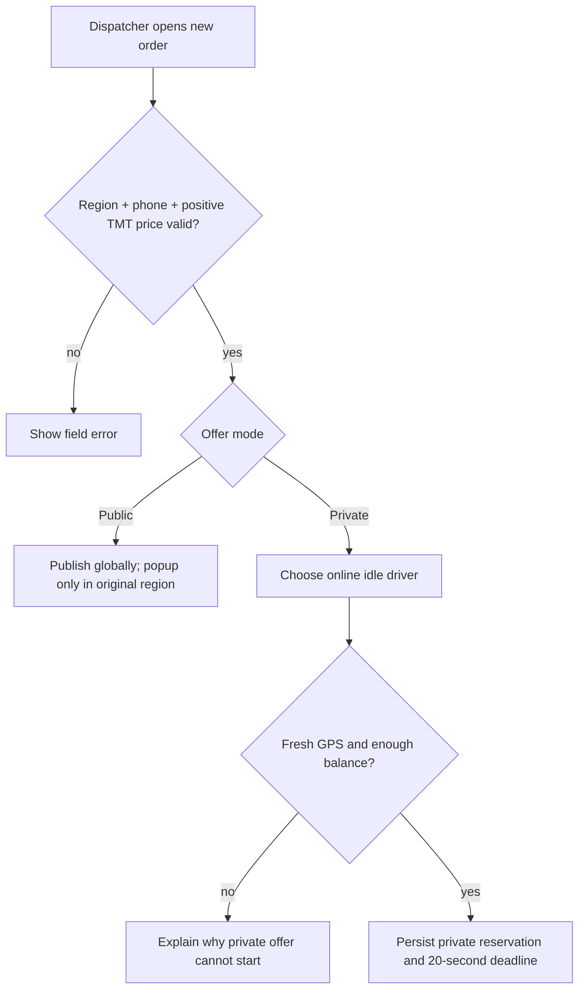
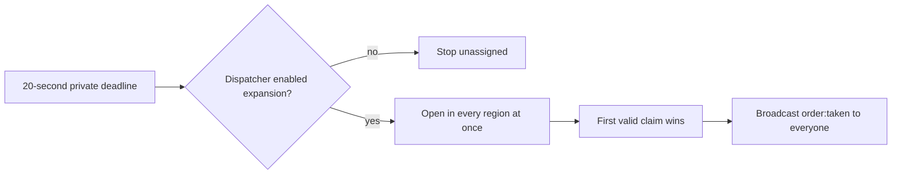
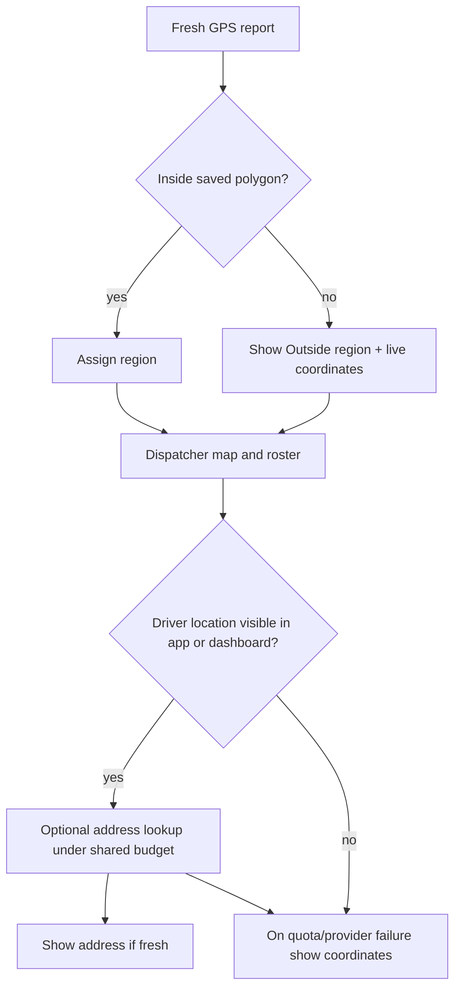
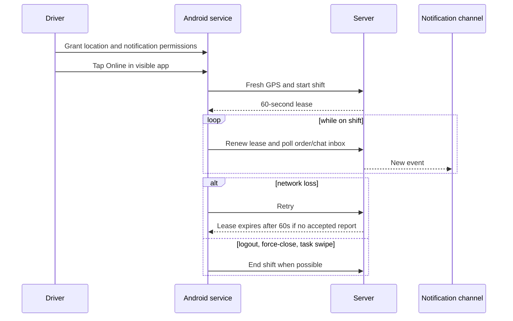

# Tayyn Hyzmat flow diagrams in English

Each diagram states whether it describes the current implementation or an approved change. Readiness-state separation and all-region expansion are in the merged release contract.

## Driver readiness and shift

Merged readiness contract (#85, `2095f56`). Hardware and background checks on the target Android phone remain release verification.


A green GPS marker means a fresh local fix. A green Online control means the server has accepted the shift. The second signal must not be inferred from the first.

## Order creation and offer choice



Map and address fields are optional. A private selection does not change the order's region.

## Private offer and first claim

```mermaid
sequenceDiagram
  participant D as Dispatcher
  participant S as Server
  participant V as Selected driver
  participant O as Other drivers

  D->>S: Create private offer
  S->>V: Safe offer, deadline = now + 20s
  V->>S: Accept or decline
  alt Accept before deadline
    S->>S: Lock order and driver, charge quoted TMT once
    S-->>V: Accepted, reveal customer phone
    S-->>O: order:taken, remove offer
  else Decline before deadline
    S->>S: Stop private delivery; preserve deadline
    S-->>V: Offer ended
    Note over S,O: No public visibility before original deadline
  else Deadline expires
    S->>S: Release reservation
    alt Expansion enabled
      S-->>O: Open in every region
    else Expansion disabled
      S-->>O: Keep order unassigned
    end
  end
```

After a private offer expires, the dispatcher choice controls the next state:



There is no second timer or incoming popup after expansion. Public announcements are immediately claimable globally; the original region alone receives the 20-second popup.

## Balance and trip lifecycle

```mermaid
stateDiagram-v2
  [*] --> Public
  Public --> Cancelled: dispatcher cancellation before acceptance
  Public --> Reserved: private offer
  Public --> Accepted: first valid public claim
  Reserved --> Accepted: selected driver accepts before 20s
  Reserved --> Reserved: early decline; stop delivery until deadline
  Reserved --> Public: expiry with expansion
  Reserved --> Stopped: expiry without expansion
  Accepted --> Waiting: driver arrives
  Waiting --> Started: customer boards
  Waiting --> Cancelled: driver or dispatcher cancellation
  Started --> Completed: driver completes
  Started --> Completed: dispatcher force-completes with reason
  Accepted --> Cancelled: dispatcher cancellation
  Completed --> [*]
  Cancelled --> [*]
```



The server enforces the actor-specific cancellation path shown here. The driver can cancel only in Waiting. The dispatcher can cancel before Started, including New and Accepted. Started has no ordinary cancellation path. Force-resolution records a completed order, not a separate status. The quoted amount is charged once at acceptance. Completion does not charge again or refund it. A lost connection keeps an accepted trip assigned while new work is blocked.

## Location, address, and dispatcher map

GPS, map paths, and the shared server address budget are merged. Provider activation is a separate deployment check.



GPS remains authoritative. Address text never controls eligibility.

## Android delivery and recovery



The server deadline is authoritative. Doze, battery saver, or manufacturer limits can delay a notification and must be tested on a physical Infinix Android 14 phone.
