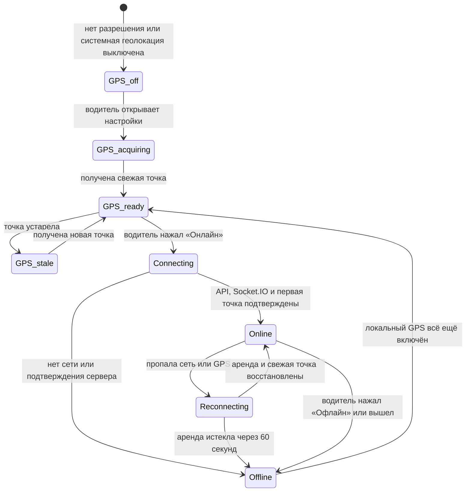
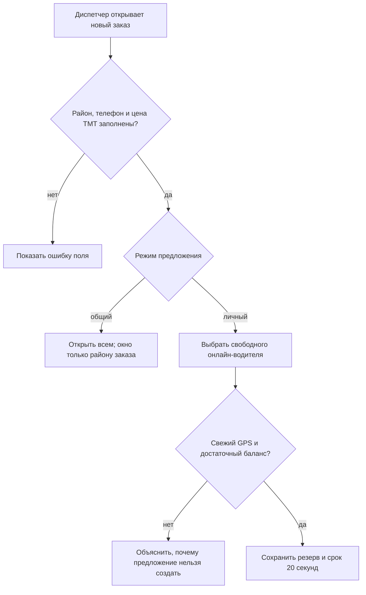
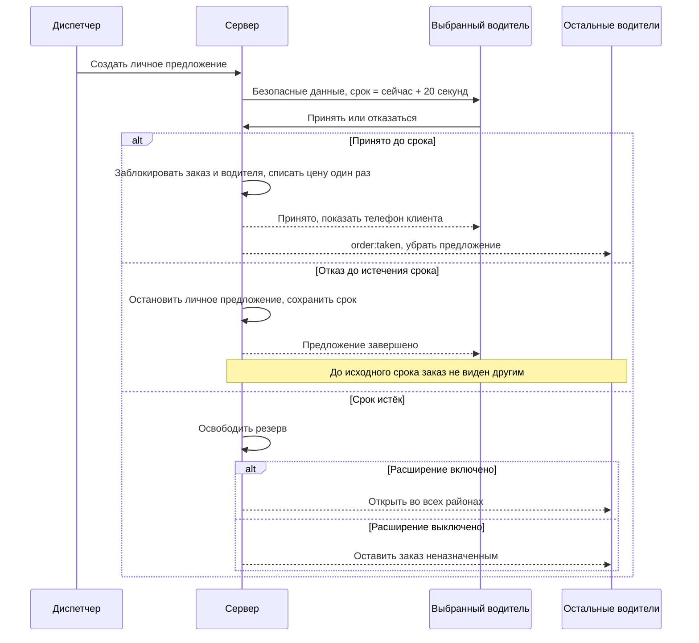
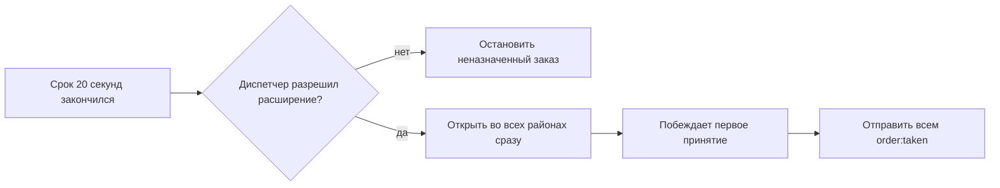
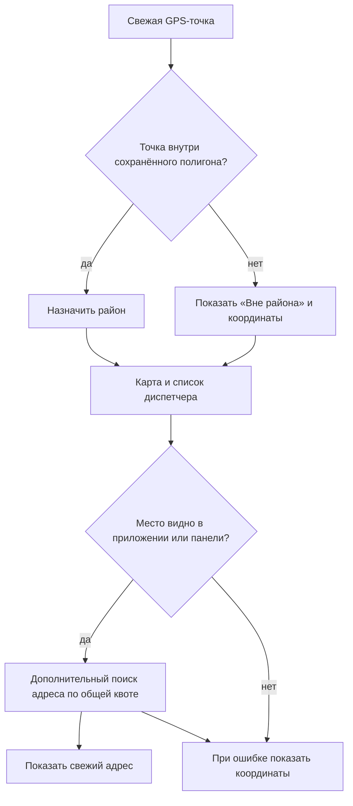
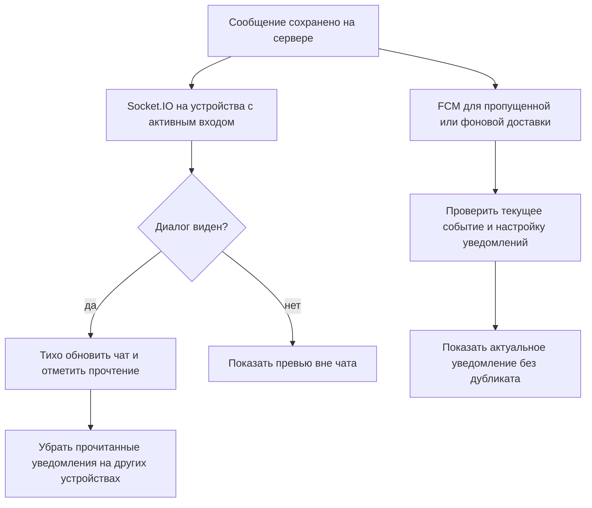
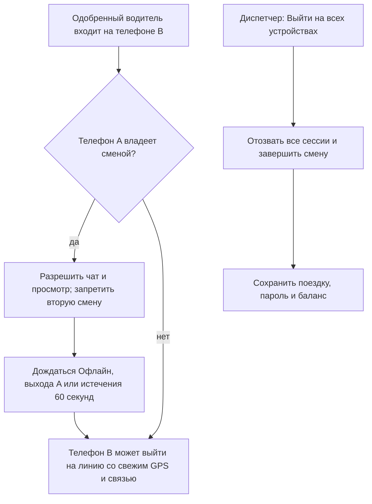
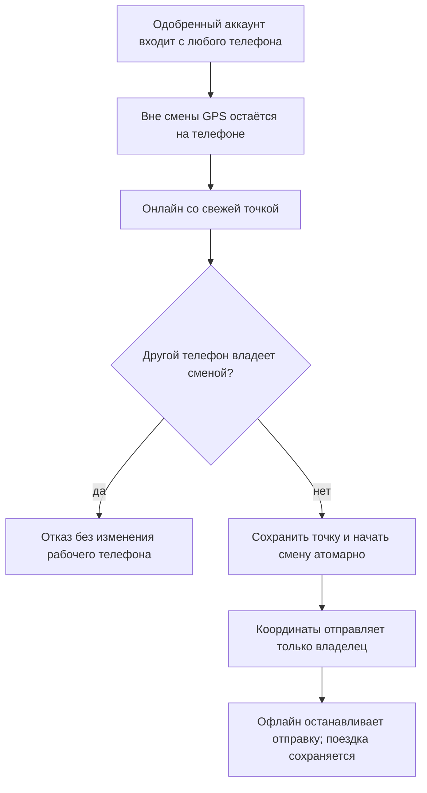
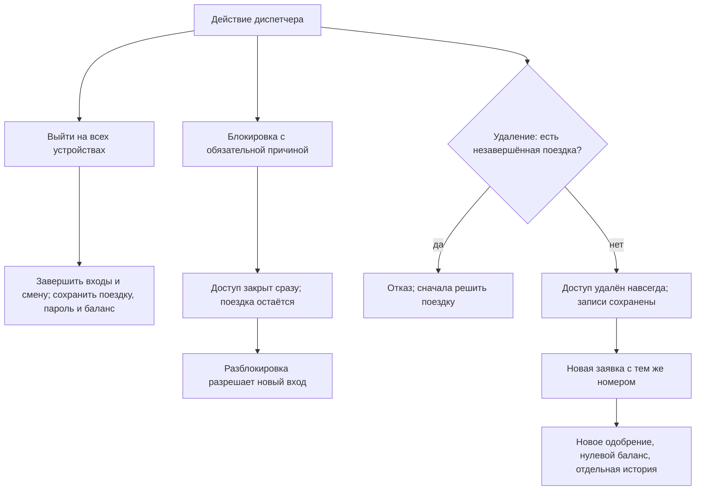

# Диаграммы потоков Tayyn Hyzmat

У каждой диаграммы указано, где показано текущее поведение, а где согласованный план. Контракт готовности и расширение на все районы уже слиты; проверка на телефоне остаётся частью выпуска.

## Готовность водителя и смена

Слитый контракт готовности (#85, `2095f56`). Проверки фоновой работы и оборудования на целевом телефоне остаются частью подготовки выпуска.



Зелёный значок GPS означает свежую локальную точку. Зелёная кнопка «Онлайн» означает подтверждённую сервером смену. Одно не заменяет другое.

## Создание заказа и выбор предложения



Карта, адрес и точки A/B необязательны. Личный выбор не меняет район заказа.

## Личное предложение и гонка принятия



После истечения личного предложения выбор диспетчера определяет следующий статус:



После расширения второго таймера и всплывающего предложения нет. Публичный заказ сразу доступен во всех районах; окно на 20 секунд получают только водители района заказа.

## Баланс и поездка

```mermaid
stateDiagram-v2
  [*] --> Public
  Public --> Cancelled: отмена диспетчером до принятия
  Public --> Reserved: личное предложение
  Public --> Accepted: первое правильное принятие
  Reserved --> Accepted: выбранный водитель принял до 20 секунд
  Reserved --> Reserved: ранний отказ; доставка остановлена до срока
  Reserved --> Public: срок истёк, расширение включено
  Reserved --> Stopped: срок истёк, расширение выключено
  Accepted --> Waiting: водитель приехал
  Waiting --> Started: клиент сел
  Waiting --> Cancelled: отмена водителем или диспетчером
  Started --> Completed: водитель завершил поездку
  Started --> Completed: диспетчер завершил с причиной
  Accepted --> Cancelled: отмена диспетчером
```



Сервер проверяет показанное правило для каждой роли. Водитель может отменить только Waiting. Диспетчер может отменить до Started, в том числе New и Accepted. Для Started обычной отмены нет. Ручное завершение записывается как Completed, отдельного статуса Resolved нет. Цена списывается один раз при принятии. Завершение не списывает и не возвращает её повторно. При разрыве связи принятый заказ остаётся закреплённым, а новые предложения блокируются.

## GPS, адрес и карта диспетчера

GPS, карта и общий серверный бюджет адресов уже слиты. Включение провайдера проверяется отдельно.



GPS определяет право на работу. Адрес не определяет район.

## Android: доставка и восстановление

```mermaid
sequenceDiagram
  participant U as Водитель
  participant A as Служба Android
  participant S as Сервер
  participant N as Канал уведомлений

  U->>A: Разрешить точную геолокацию; уведомления необязательны
  U->>A: Нажать Онлайн в открытом приложении
  A->>S: Передать свежий GPS и начать смену
  S-->>A: Подтверждённая доступность на 60 секунд
  loop Во время смены
    A->>S: Продлить доступность и проверить заказы и чат
    S-->>N: Новое событие
  end
  alt Пропала сеть
    A->>S: Повторить соединение
    S-->>A: Доступность истекает без новой подтверждённой точки
  else Кнопка «Офлайн» или выход
    A->>S: Завершить смену, если связь доступна
  end
```

Смахивание из списка задач сохраняет смену. Системная остановка Android блокирует доставку до нового открытия; без отчётов доступность истекает. После неудачного восстановления за 60 секунд водитель снова нажимает «Онлайн». Разрешение уведомлений не требуется для начала смены.

Срок сервера определяет доступность. Doze, экономия батареи и ограничения производителя могут задерживать уведомления. Это ещё нужно проверить на физическом Infinix Android 14.

## Чат на устройствах с активным входом



Для чата не нужны GPS и активная смена. В профиле один переключатель уведомлений; он не блокирует начало смены. Разрешения Android, сеть и ограничения батареи продолжают действовать.

## Одобрение аккаунта и одна рабочая смена

В кандидате остаётся одобрение аккаунта, отдельное одобрение устройств убрано.



При потере телефона также сбросьте пароль. Один выход не запрещает новый вход с тем же паролем.

## Доступ и локальная геопозиция




