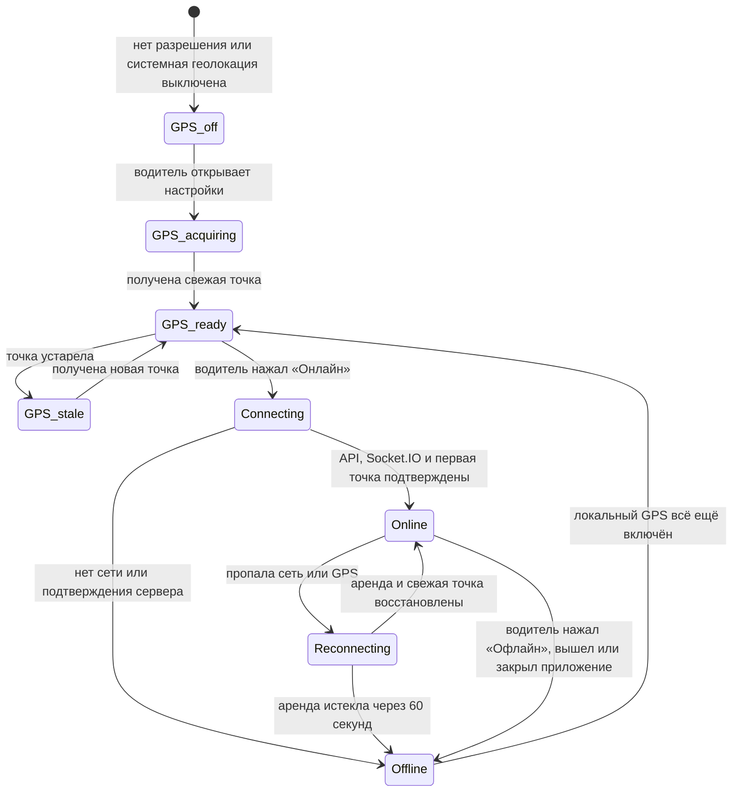
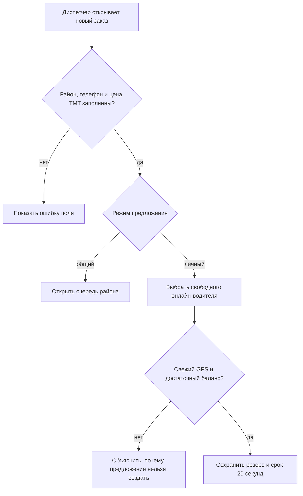
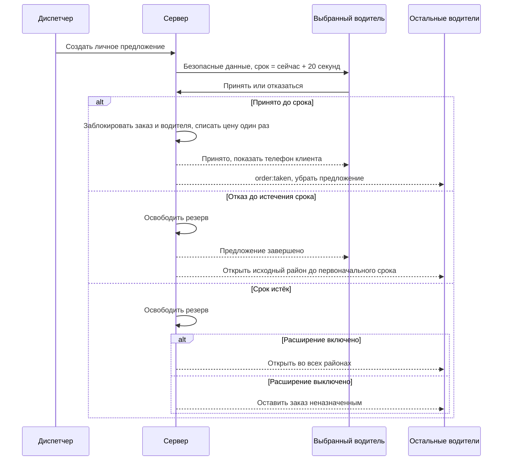
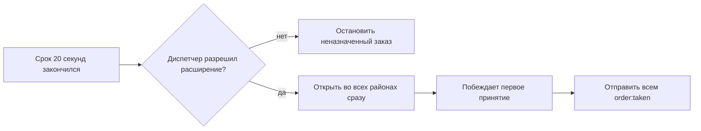
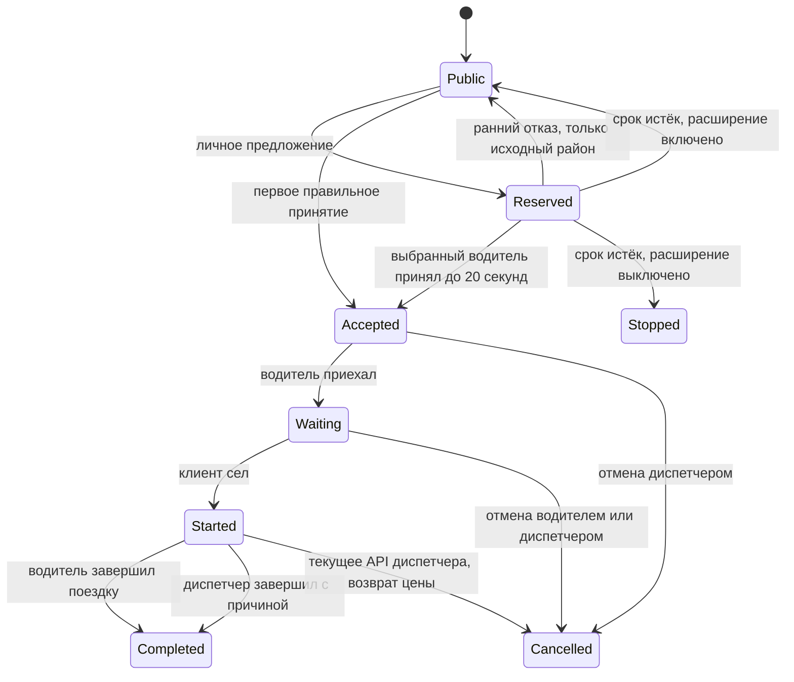
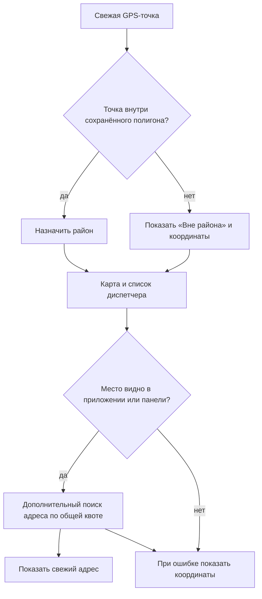

# Диаграммы потоков Tayyn Hyzmat

У каждой диаграммы указано, где показано текущее поведение, а где согласованный план. Контракт готовности и расширение на все районы уже слиты; проверка на телефоне остаётся частью выпуска.

## Готовность водителя и смена

Слитый контракт готовности (#85, `2095f56`). Проверки фоновой работы и оборудования на целевом телефоне остаются частью подготовки выпуска.

Зелёный значок GPS означает свежую локальную точку. Зелёная кнопка «Онлайн» означает подтверждённую сервером смену. Одно не заменяет другое.

## Создание заказа и выбор предложения

Карта, адрес и точки A/B необязательны. Личный выбор не меняет район заказа.

## Личное предложение и гонка принятия

После истечения личного предложения выбор диспетчера определяет следующий статус. Поведение слито в #79 (`715b648`):

После расширения второго таймера нет.

## Баланс и поездка

Показано целевое правило отмены. Сейчас API дополнительно разрешает водителю отмену из Accepted, это известный пробел. Принудительное завершение записывается как Completed, отдельного статуса Resolved нет. Цена списывается один раз при принятии. После начала поездки водитель отменять не может. При разрыве связи принятый заказ остаётся закреплённым, а новые предложения блокируются.

## GPS, адрес и карта диспетчера

GPS, карта и общий серверный бюджет адресов уже слиты. Включение провайдера проверяется отдельно.

GPS определяет право на работу. Адрес не определяет район.
