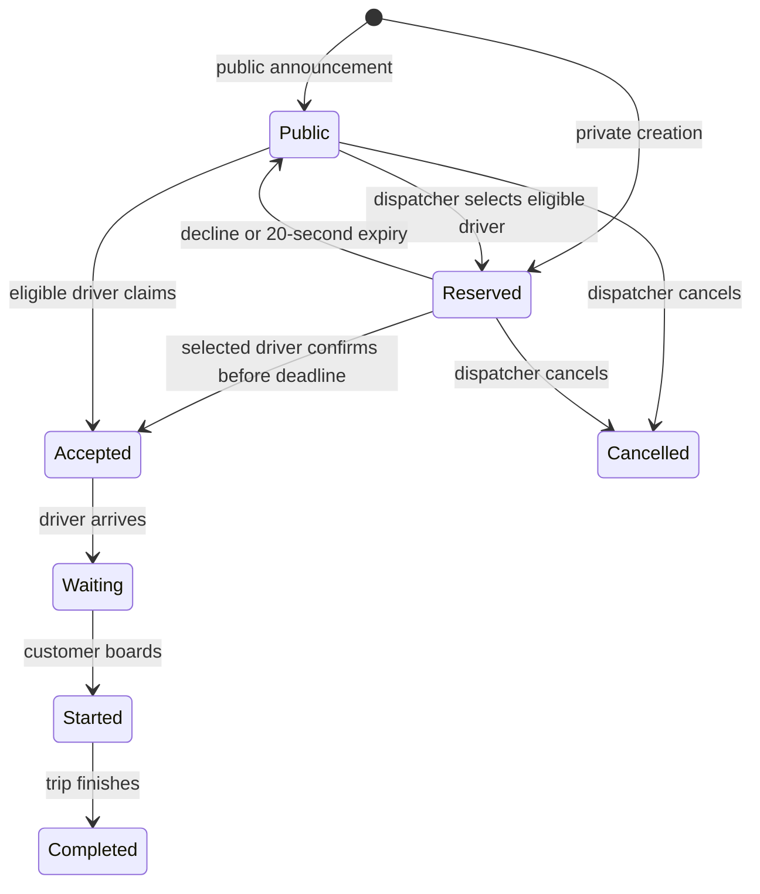

# Private driver offers

A dispatcher can announce an order publicly or offer it privately to one driver. Choose **Личное предложение** when creating an order, use **Предложить водителю** on an unclaimed order, or select a driver on the monitoring map/list and choose an existing or new order.

Private offers require an approved, online, idle driver with a fresh GPS report and positive synthetic balance. The dispatcher may select a driver in another region; selection changes neither the driver's region nor the order's region. A driver may have one active trip or one pending private offer.

The server reserves the order for 20 seconds and persists the deadline. Only the selected driver can explicitly accept it. Reserving the order does not charge the balance or reveal the customer phone. Successful acceptance charges the quoted TMT price once, reveals the phone and continues through the existing accepted → waiting → started → completed trip controls.

Declining or reaching the deadline releases the order to its original region's public queue. A late private response cannot accept or decline a later reservation. Dispatcher cancellation dismisses the private offer immediately. Public claims, reservations and private acceptance compete through conditional order writes and a driver row lock.

Socket.IO delivers private offers to the selected driver's room. HTTP recovery returns the same persisted deadline after reconnect. Full browser reload retains the reservation on the server, but the existing GPS rule requires enabling GPS and going online again before recovering available work. Reload never extends the deadline. The response includes the server-computed remaining duration; the browser counts down with a monotonic clock, so a wrong phone clock does not discard a valid offer. Server expiry is checked during actions and by a one-second sweep; after a server restart the sweep releases elapsed reservations.

This delivery works while the browser is running and connected. Native background delivery and locked-phone availability remain separate APK work. The audit also tracks unrelated authentication, stale-request and trip/refund concurrency gaps; this feature does not establish APK release readiness.

## Public contracts

- Admin order creation accepts optional `privateOfferDriverId`.
- `POST /admin/orders/:id/private-offer` takes `{ driverId }`.
- `GET /orders/private-offer` returns the selected driver's current safe offer or `null`; fresh GPS and online status are required.
- `POST /orders/private-offer/accept` takes `{ orderId, privateOfferExpiresAt, etaMinutes? }`.
- `POST /orders/private-offer/decline` takes `{ orderId, privateOfferExpiresAt }`.
- `order:private-offer` contains safe order information and the ISO `privateOfferExpiresAt` deadline and `privateOfferRemainingMs`; `order:private-offer-ended` contains `{ orderId, privateOfferExpiresAt }`.

The original deadline identifies a reservation. Public acceptance cannot bypass an active reservation, including for its selected driver. No preacceptance HTTP or driver socket payload contains `clientPhone`.

## Migration and verification

The additive migration adds nullable reservation columns, a driver foreign key and a partial unique index allowing one NEW reservation per driver. Existing orders remain public. Roll back application code before dropping columns through a later forward migration; expire outstanding reservations first. No canonical region geometry changes.

HTTP and Socket.IO tests use disposable PostgreSQL and cover persisted deadlines, real-time expiry, recovery, phone privacy, no preacceptance debit, cross-region eligibility, decline, stale responses, cancellation and concurrent claims/reservations. Browser workflows cover private creation and trip completion, map-selected existing-order offers, reconnect and decline. Delayed-response and skewed-phone-clock browser cases guard reservation identity and the countdown. Native delivery is not exercised by these tests.
